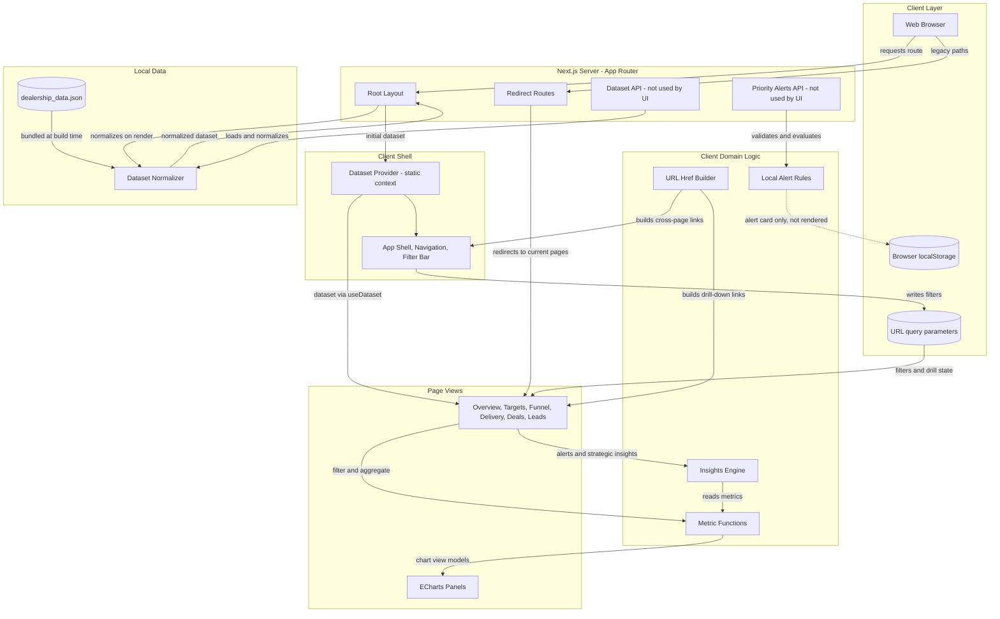
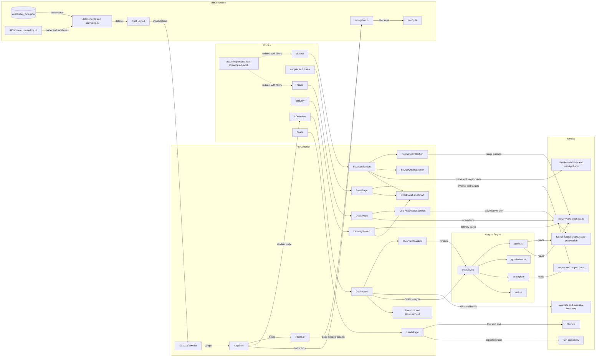

# Architecture Diagram

DealerPulse on branch `feat/targets-branches-team` is a Next.js dashboard. The server renders a local JSON fixture that is bundled at build time and normalized by the root layout, and the browser computes all filters, metrics, and insights from that dataset. Navigation is driven by URL query parameters.

## Application Architecture

<!-- mermaid-checked: no \n, no em-dash/en-dash, no {} in labels, subgraphs are id["label"], arrows are -->|"label"|, all subgraphs closed by end, ids unique -->

### Technology Stack Summary

| Layer | Technology | Version | Purpose |
|---|---|---|---|
| Web framework | Next.js | ^15.0.0 | App Router pages, server layout, redirects, and API routes |
| UI | React | ^19.0.0 | Client components and context |
| Language | TypeScript | ^5.6.0 | Typed dataset, filter, and metric models |
| Visualization | Apache ECharts | ^5.5.0 | Charts with a shared theme and design tokens |
| Icons | lucide-react | ^1.53.0 | Navigation and UI icons |
| Styling | Tailwind CSS tooling and CSS files | ^3.4.0 | Global styles split under `app/styles` |
| Fonts | next/font Inter | n/a | Application typography |
| Test framework | Vitest | ^2.1.0 | Metric, insight, navigation, and format tests |
| Runtime | Node.js | 20 or later | Next.js server and verify script |

### Data Storage & External Services

There is no database, cache, message broker, or external API. The only data source is `data/dealership_data.json`, a static file imported into the app bundle at build time (not read from disk at request time). The root layout normalizes it on each server render and passes it to a client context provider, so the browser receives the full dataset with the page. Data changes require a rebuild and redeploy. The app has no client polling or live toggle. `/api/dataset` (hash and ETag) and `/api/ai-alerts` (deterministic rules, no AI provider) still exist, but no component on this branch calls them. `ai-alerts-card.tsx` is not rendered by any page; it would use `localStorage` for done and discarded state.

### Key Architectural Decisions

- Filters are URL query parameters. Global keys (from, to, range, branch, source, model, basis) carry across pages, and `lib/navigation.ts` allows page-local keys only on the leads page.
- Metrics and insights are pure functions over the normalized dataset and filter state, so the browser recomputes views without server calls.
- Legacy routes (`/team`, `/representatives`, `/branches`, `/branch/:id`) redirect to the Funnel and Deals pages, keeping filters.

## Component Relationships

<!-- mermaid-checked: no \n, no em-dash/en-dash, no {} in labels, subgraphs are id["label"], arrows are -->|"label"|, all subgraphs closed by end, ids unique -->

### Component Inventory

| Component | Layer | Type | Responsibility |
|---|---|---|---|
| Root Layout | Infrastructure | Server component | Normalizes the bundled dataset on each render, loads the Inter font, and wraps pages in provider and shell |
| DatasetProvider | Presentation | React context | Serves the initial dataset to client pages through `useDataset` (no polling) |
| AppShell | Presentation | Client component | Main navigation, breadcrumbs, and hosting the filter bar |
| FilterBar | Presentation | Client component | Writes global filter query parameters scoped to the current page |
| Dashboard (/) | Presentation | Client page | KPIs, branch health table, overdue items, and overview insight blocks |
| SalesPage (/targets, /sales) | Presentation | Client page | Targets and revenue, branch comparison, and rankings |
| FocusedSection and FunnelTeamSection (/funnel) | Presentation | Client page | Funnel charts, team and representative breakdown, and source quality |
| DeliverySection (/delivery) | Presentation | Client page | Delivery aging, delays, and overdue orders |
| DealsPage and DealProgressionSection (/deals) | Presentation | Client page | Open deals in progress, stage conversion, and loss reasons |
| LeadsPage (/leads) | Presentation | Client page | Filterable, sortable lead list with win probability and expected value |
| OverviewInsights | Presentation | Client component | Renders ranked alerts, good news, and strategic insights |
| ChartPanel and Chart | Presentation | Client components | ECharts wrapper with shared theme and chart tokens |
| Insights Engine (`lib/insights`) | Insights | Pure functions | Builds alerts, good news, and strategic insights, then ranks them by impact and effort |
| Metrics (`lib/metrics`) | Metrics | Pure functions | Filtering, KPIs, targets, funnel, stage progression, delivery, open leads, and win probability |
| navigation.ts and config.ts | Infrastructure | Helpers and constants | Cross-page href building, global and page-local query keys, stages, thresholds, and insight text |
| Dataset loader and normalizer | Infrastructure | Server data access | Imports the bundled JSON fixture and builds typed, indexed data |
| Redirect routes | Routes | Next.js routes | Forward legacy paths to Funnel or Deals while keeping filters |
| API routes | Infrastructure | Next.js routes | `/api/dataset` and `/api/ai-alerts` exist but are not called by any component on this branch |
